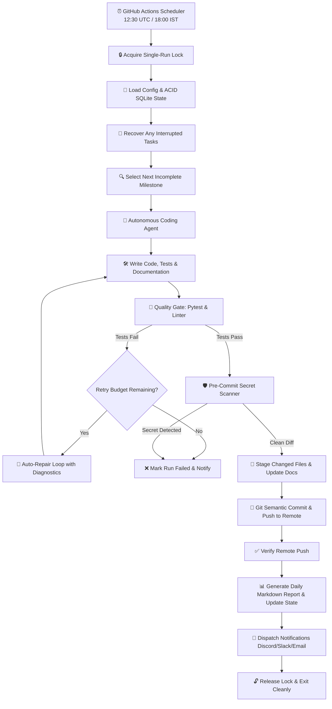

# 🤖 Autonomous 30-Day Project Builder Agent

> **An enterprise-grade, fully autonomous engineering agent that independently plans, implements, tests, documents, and pushes real software progress to GitHub every day at 12:00 AM IST (18:30 UTC) for 30 consecutive days — even when your computer is shut down or your IDE is closed.**

---

## 🌟 Overview & Key Capabilities

- **Zero Manual Daily Intervention:** Executes in the cloud via GitHub Actions scheduled workflows (`cron: '30 18 * * *'`), requiring zero human involvement after one-time setup.
- **Genuine GitHub Contribution Streak:** Commits and pushes verified, tested code modifications every single day with semantic conventional commits.
- **Project-Specific 30-Day Roadmap:** Automatically generates a comprehensive 30-day technical plan divided into 5 development phases and persists it in SQLite and Markdown.
- **Multi-Model LLM Portability:** Pluggable provider architecture supporting **Google Gemini (gemini-2.5-flash)**, **OpenAI (gpt-4o-mini)**, **Anthropic (Claude 3.5 Sonnet)**, and an offline **Deterministic Mock Provider**.
- **Automated Quality Gate:** Enforces test suite execution, syntax/linter checks, and diff validation before any code is committed.
- **Pre-Commit Secret Scanner:** Scans diffs and files for API keys, private keys, AWS credentials, and `.env` files to guarantee security.
- **Bounded Auto-Repair Loop:** Automatically captures test failures and prompts the LLM to fix bugs before retrying (up to configurable `max_retries`).
- **Resilient Crash Recovery & Concurrency Guard:** ACID SQLite transaction store and single-run lock (`.agent.lock`) prevent duplicate runs and safely recover interrupted tasks without losing progress.
- **Audit Reports & Progress Trackers:** Updates `ROADMAP.md`, `PROGRESS.md`, `CHANGELOG.md`, and generates daily reports under `reports/daily/YYYY-MM-DD.md`.
- **Multi-Channel Notifications:** Alerts you via Discord/Slack Webhook and SMTP Email on success or failure.

---

## 🏗️ Architecture & Component Flow



---

## ⏰ Why Execution Runs Unattended (No IDE Required)

| Execution Model | How it Works | Stays Alive When IDE is Closed? |
| :--- | :--- | :---: |
| **GitHub Actions (Primary)** | GitHub's hosted runners wake up daily in the cloud at **12:30 UTC (6:00 PM IST)**, pull your repository, install dependencies, load secrets from repository settings, execute the daily milestone, run tests, and push the verified commit back to GitHub. | **YES (100% Unattended Cloud)** |
| **Windows Task Scheduler (Local)** | Registers a persistent Windows scheduled task via `scripts/setup_windows_task.ps1` that wakes your machine or runs in the background. | **YES (Runs via OS Service)** |
| **Linux / Server Cron (Local)** | Registers a crontab entry via `scripts/setup_cron.sh` on an always-on VPS or home server. | **YES (Runs via system crond)** |
| **IDE Internal Script / Terminal** | Process stops immediately when the IDE or terminal window is closed. | **NO (Fails unattended requirement)** |

> [!NOTE]
> GitHub Actions uses **UTC** for cron expressions. India Standard Time (IST) is **UTC+05:30**.
> - **12:00 AM IST (00:00 midnight)** = **6:30 PM UTC (18:30)**.
> - The cron schedule is configured as `30 18 * * *`.
> - GitHub Actions cron jobs may occasionally queue during high load, but will execute reliably every day.

---

## 📁 Repository Structure

```text
├── .github/
│   └── workflows/
│       └── daily-project-agent.yml     # Scheduled GHA workflow (runs 12:30 UTC / 18:00 IST)
├── config/
│   └── default_config.yaml             # Fallback default configuration
├── docs/                               # Architecture and API documentation
├── reports/
│   └── daily/                          # Automated daily execution reports (YYYY-MM-DD-day-XX.md)
├── scripts/
│   ├── setup_windows_task.ps1          # Windows Task Scheduler registration script
│   └── setup_cron.sh                   # Linux/macOS crontab registration script
├── src/
│   ├── __init__.py
│   ├── cli.py                          # Click CLI commands and setup wizard
│   ├── config.py                       # Config loader, schema validator, timezone converter
│   ├── executor/
│   │   ├── agent.py                    # Coding agent loop with auto-repair
│   │   └── tools.py                    # Sandboxed workspace filesystem tools
│   ├── git/
│   │   └── client.py                   # Safe Git staging, committing, pushing, and verification
│   ├── notifications/
│   │   └── notifier.py                 # Discord/Slack webhook and SMTP email dispatcher
│   ├── planner/
│   │   ├── generator.py                # 30-Day milestone synthesis engine
│   │   └── roadmap_writer.py           # Markdown generator for ROADMAP.md & PROGRESS.md
│   ├── providers/
│   │   ├── base.py                     # Abstract LLM provider interface
│   │   ├── factory.py                  # Dynamic provider resolution
│   │   ├── gemini.py                   # Google Gemini REST API provider
│   │   ├── openai_compat.py            # OpenAI / DeepSeek / Groq provider
│   │   ├── anthropic.py                # Anthropic Claude provider
│   │   └── mock_provider.py            # Deterministic mock provider for offline tests
│   ├── reporting/
│   │   └── report_generator.py         # Markdown audit report builder
│   ├── scheduler/
│   │   ├── lock.py                     # Cross-platform single-instance process lock
│   │   └── runner.py                   # Daily execution master coordinator
│   ├── state/
│   │   └── manager.py                  # ACID SQLite state database (crash recovery & streaks)
│   └── testing/
│       ├── quality_gate.py             # Pre-commit test runner, linter, and diff validator
│       └── secret_scanner.py           # Credential, PAT, and private key detector
├── tests/                              # Comprehensive test suite (24 unit & integration tests)
├── .env.example                        # Template for environment credentials
├── .gitignore                          # Protects secrets, virtualenvs, and locks
├── CHANGELOG.md                        # Incremental milestone changelog
├── main.py                             # CLI root entrypoint
├── PROGRESS.md                         # Real-time visual progress tracker with streak counter
├── project.config.yaml                 # Central project configuration
├── pyproject.toml                      # Package metadata
├── README.md                           # Master documentation
├── requirements.txt                    # Python dependencies
└── ROADMAP.md                          # Full 30-day technical milestone roadmap
```

---

## 🚀 One-Time Setup Guide (10 Minutes)

Follow these steps once to activate the autonomous 30-day agent:

### Step 1: Clone or Open the Workspace
```powershell
cd "c:\Users\vamsh\Desktop\Git Agent"
```

### Step 2: Install Dependencies
```powershell
python -m pip install -r requirements.txt
```

### Step 3: Run the Setup Wizard
Launch the interactive CLI wizard:
```powershell
python main.py init
```
The wizard will prompt you for:
- Project Name and Description
- Core Goals and Tech Stack
- GitHub Repository URL (e.g. `https://github.com/your-username/your-repo`)
- Base branch (`main`)
- LLM Provider: Google Gemini (Recommended), OpenAI, Anthropic, or Mock
- API Key and GitHub Personal Access Token

### Step 4: Verify Environment and Toolchain
```powershell
python main.py verify
```
This checks that:
- Pytest and python compiler toolchains are functional
- Git repository is ready
- LLM provider credentials connect cleanly

### Step 5: Generate the 30-Day Technical Roadmap
```powershell
python main.py plan
```
This inspects your project goals and creates 30 concrete daily milestones across 5 phases, updating `ROADMAP.md` and `PROGRESS.md`.

### Step 6: Test Day 1 Locally (Dry-Run or Commit)
Run an offline dry run:
```powershell
python main.py run --day 1 --dry-run
```
Or execute and create Day 1's commit:
```powershell
python main.py run --day 1
```

### Step 7: Push the Codebase to Your GitHub Repository
```powershell
git remote add origin https://github.com/your-username/your-repo.git
git push -u origin main
```

### Step 8: Configure GitHub Actions Secrets
In your GitHub repository, navigate to **Settings** > **Secrets and variables** > **Actions** and add:
- `GEMINI_API_KEY`: Your Google AI Studio API key (or `OPENAI_API_KEY` / `ANTHROPIC_API_KEY`)
- `NOTIFICATION_WEBHOOK` *(Optional)*: Discord or Slack Webhook URL

Also ensure GitHub Actions has write permissions:
- Go to **Settings** > **Actions** > **General** > **Workflow permissions**.
- Select **"Read and write permissions"** and check **"Allow GitHub Actions to create and approve pull requests"**.
- Click **Save**.

🎉 **You are done!** GitHub Actions will now automatically trigger every day at **6:00 PM IST (12:30 UTC)**, implement the next milestone, run quality checks, push verified commits, and update your streak.

---

## 🛠️ CLI Command Reference

| Command | Description | Example |
| :--- | :--- | :--- |
| `python main.py init` | Interactive setup wizard configuring project, repository, and provider | `python main.py init` |
| `python main.py plan` | Generates or regenerates the 30-day technical roadmap | `python main.py plan --force` |
| `python main.py run` | Executes milestone development cycle | `python main.py run --auto` |
| `python main.py run --day N` | Targets a specific milestone day (1–30) | `python main.py run --day 5` |
| `python main.py run --dry-run` | Executes coding and testing without committing or pushing | `python main.py run --day 1 --dry-run` |
| `python main.py status` | Displays progress dashboard, active milestone, and streak counter | `python main.py status` |
| `python main.py verify` | Validates git setup, test runners, and AI model connectivity | `python main.py verify` |
| `python main.py daemon` | Runs persistent local scheduler loop for always-on machines | `python main.py daemon` |

---

## 🗓️ 30-Day Development Lifecycle Phases

```text
Phase 1: Foundation (Days 1–5)
├── Day 01: Project Architecture, Scaffolding, and Environment Validation
├── Day 02: Telemetry Data Models, Schema Validation, and Envelope Types
├── Day 03: High-Throughput In-Memory Ring Buffer & Sliding Window
├── Day 04: Persistent Timeseries Storage Adapter (SQLite & WAL Engine)
└── Day 05: Automated Health Checks, Logging Subsystem, and Baseline Suite

Phase 2: Core Functionality (Days 6–12)
├── Day 06: Asynchronous HTTP & REST Ingestion Endpoints
├── Day 07: Streaming Metrics Aggregator (Quantiles & Percentiles)
├── Day 08: Prometheus Exporter & OpenTelemetry Protocol Adapter
├── Day 09: Dynamic Tag Filtering & Dimensional Indexing
├── Day 10: API Authentication, Token Rotation, and Rate Limiting
├── Day 11: Timeseries Query Engine & DSL Parsing
└── Day 12: Phase 2 Integration Verification & End-to-End Test Suite

Phase 3: Advanced Features (Days 13–19)
├── Day 13: Dynamic Threshold Alerting Rule Engine
├── Day 14: Multi-Channel Notification Dispatcher (Webhook & Email)
├── Day 15: Real-Time Anomaly Detection via Moving Z-Score & Holt-Winters
├── Day 16: Terminal UI & Interactive CLI Dashboard
├── Day 17: Distributed Tracing Context Propagation (W3C TraceContext)
├── Day 18: Timeseries Data Compression & Retention Pruner
└── Day 19: Phase 3 Advanced Feature Integration & Stress Benchmark

Phase 4: Reliability & Polish (Days 20–25)
├── Day 20: Comprehensive Edge-Case Testing & Fuzz Testing
├── Day 21: Concurrency Hardening & Race Condition Elimination
├── Day 22: Database Query Optimization & WAL Checkpointing
├── Day 23: Circuit Breaker & Graceful Degradation Policy
├── Day 24: Security Hardening, Dependency Audit, and Secret Scrubbing
└── Day 25: Full Regression & 90%+ Test Coverage Audit

Phase 5: Release & Deployment (Days 26–30)
├── Day 26: Production Configuration Engine & Environment Profiles
├── Day 27: Containerization & Multi-Arch Dockerfile Configuration
├── Day 28: End-to-End Production Verification & Smoke Test Suite
├── Day 29: Comprehensive Developer Guide, Architecture Specs, and API Docs
└── Day 30: Final Acceptance Audit, Release v1.0.0 Tagging, and 30-Day Retrospective
```

---

## 🔒 Security, Safety & Secret Scrubbing

1. **Zero Credential Exposure:** Secrets and tokens are read exclusively from environment variables or GitHub Actions Secrets. All remote Git URLs have credentials automatically sanitized before logging.
2. **Pre-Commit Secret Scanner:** The agent checks diffs and filenames for sensitive patterns (AWS keys, GitHub tokens, Google API keys, OpenAI keys, private keys, `.env` files). Commits are rejected if a violation is detected.
3. **No Destructive Operations:** The agent uses only safe Git commands (`git add`, `git commit`, `git push`). Destructive commands like `git reset --hard` or `git clean -fd` on user files are prohibited.
4. **No Artificial Contributions:** Only meaningful, tested, working code and documentation changes are committed. Empty commits, fake whitespace changes, and mock commits are strictly forbidden.
5. **Sandboxed Workspace Operations:** `WorkspaceTools` enforces workspace-root containment, preventing directory traversal attacks or external modifications.

---

## 🧪 Automated Test Suite

Run the full automated test suite anytime:

```powershell
python -m pytest tests/ -v
```

All 24 automated unit and integration tests verify:
- ✅ Config loading & IST-to-UTC cron conversion
- ✅ ACID SQLite state persistence, milestone transitions & streak calculation
- ✅ Abnormal termination crash recovery
- ✅ Secret scanning across diffs, content & file paths
- ✅ Single-run process lock & concurrent run prevention
- ✅ 30-Day roadmap generation & markdown rendering
- ✅ Quality gate diff validation, test execution & failure rejection
- ✅ Safe GitClient operations, staging, commit creation & token sanitization
- ✅ Coding agent task execution & auto-repair loop
- ✅ End-to-end execution runner cycle & idempotency
